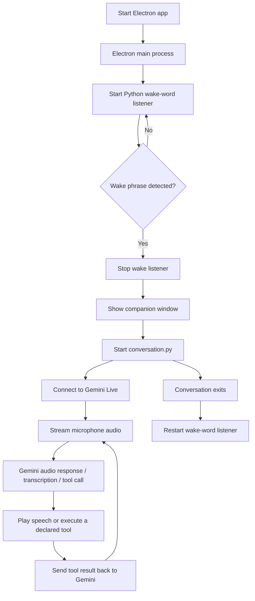

# Belizarius

**Belizarius is a voice-controlled desktop companion built with Electron, React, TypeScript, Python, Sherpa-ONNX, and the Gemini Live API.** It is designed to listen for a local wake phrase, open a small desktop companion window, hold a continuous spoken conversation, and carry out a limited set of desktop actions through explicitly declared tools.

> **Project status:** Development prototype. The code shown here is Windows-oriented and relies on local Python environments, a local wake-word model, microphone/speaker access, and a Gemini API key. Review the setup and limitations below before using it as a daily driver.

## Contents

- [Features](#features)
- [How it works](#how-it-works)
- [Technology stack](#technology-stack)
- [Project structure](#project-structure)
- [Requirements](#requirements)
- [Installation](#installation)
- [Configuration](#configuration)
- [Running Belizarius](#running-belizarius)
- [Voice commands and available tools](#voice-commands-and-available-tools)
- [Audio and wake-word configuration](#audio-and-wake-word-configuration)
- [Security and privacy](#security-and-privacy)
- [Troubleshooting](#troubleshooting)
- [Development notes and known limitations](#development-notes-and-known-limitations)
- [Testing](#testing)
- [Contributing](#contributing)
- [License](#license)

## Features

### Voice interaction

- Local wake-word detection using Sherpa-ONNX and an ONNX keyword-spotting model.
- Continuous, real-time voice conversation through the Gemini Live API.
- Microphone input streamed to Gemini as audio rather than requiring a separate manual transcription step.
- Spoken Gemini responses played through the default output device.
- Input and output transcription messages emitted by the Python conversation engine for the Electron process to display or log.
- Barge-in handling: when Gemini reports that the user interrupted its speech, queued playback is cleared and the active speaker stream is flushed while the Live session's context is retained.
- Tool calls can run concurrently when Gemini requests independent actions, and tool results are sent back to Gemini so it can report the outcome.

### Desktop companion

- A compact, frameless, transparent, always-on-top Electron window.
- A React interface with an animated aura and a companion image.
- A wake-phrase notification in the interface.
- A visibility-mode IPC handler (`TRANSPARENCY` or `STEALTH`) in the Electron main process.
- IPC channels for wake-word events, voice status, recognized input, spoken output, and activity events.

### Desktop actions

The Python tool layer supports a small, explicit set of actions: workspace file operations, opening a website, opening a YouTube result, changing Windows master volume, retrieving the computer's local date and time, and opening a prefilled email draft. File access is restricted to the project's `Belizarius_Workspace` directory. Email is drafted locally and is **not** sent automatically.

## How it works



### Process responsibilities

1. **Electron main process (`electron/main.ts`)** creates the desktop window, launches and supervises the Python processes, parses their standard output, sends events to the renderer over IPC, and restarts the wake listener after a conversation ends.
2. **Wake-word listener (`voice_engine/wake_sherpa.py`)** captures microphone audio, converts it from the configured 48 kHz device rate to 16 kHz, and runs local Sherpa-ONNX keyword spotting. When a phrase is detected, it prints a `WAKE_WORD:` line for Electron to consume.
3. **Conversation engine (`voice_engine/conversation.py`)** opens a Gemini Live session, continuously streams microphone audio, receives model output, plays generated audio, and handles function calls. It also emits recognizable log lines such as `GEMINI_CONNECTED`, `YOU SAID:`, `BELIZARIUS:`, and `TURN_COMPLETE`.
4. **Desktop tools (`voice_engine/os_tools.py` plus the dispatcher in `conversation.py`)** execute only the actions declared in the Gemini tool definitions.
5. **Renderer (`src/App.tsx`)** renders the companion interface. `electron/preload.ts` exposes a constrained `window.electronAPI` bridge for communicating with the main process.

## Technology stack

| Layer | Technology | Role |
|---|---|---|
| Desktop shell | Electron | Window lifecycle, child processes, IPC |
| Frontend | React, TypeScript, Vite | Companion UI |
| Wake-word detection | Sherpa-ONNX + ONNX model | Local keyword spotting |
| Audio capture/playback | `sounddevice` / PortAudio | Microphone and speaker streams |
| Audio processing | NumPy, SciPy | PCM handling and sample-rate conversion |
| Conversational AI | Google GenAI SDK + Gemini Live | Real-time audio conversation and function calling |
| Configuration | `python-dotenv` | Load the root `.env` file |
| Optional integrations | `yt-dlp`, `pycaw`, `comtypes` | YouTube video resolution and Windows master-volume control |

## Project structure

The following represents the source layout visible in the project. Generated build output and local virtual environments may be present on your machine but generally should not be committed to version control.

```text
Belizarius/
├── Belizarius_Workspace/       # Files Belizarius is permitted to manage
├── dist-electron/              # Generated Electron main/preload build output
├── electron/
│   ├── electron-env.d.ts       # Electron/Vite environment types
│   ├── main.ts                 # Window, Python process management, IPC handlers
│   └── preload.ts              # Renderer-safe IPC bridge
├── public/                     # Static public assets
├── src/
│   ├── assets/                 # Companion image and other UI assets
│   ├── App.css                 # Companion styling
│   ├── App.tsx                 # Main React companion UI
│   ├── electron.d.ts           # Renderer type declarations, if used
│   ├── index.css               # Global styles
│   ├── main.tsx                # React entry point
│   ├── shared-types.ts         # Types shared by Electron and the renderer
│   └── vite-env.d.ts           # Vite environment types
├── voice_engine/
│   ├── .venv/                  # Local Python virtual environment (create locally)
│   ├── models/
│   │   └── sherpa-onnx-kws-zipformer-gigaspeech-3.3M-2024-01-01/
│   │       ├── tokens.txt
│   │       ├── encoder-epoch-12-avg-2-chunk-16-left-64.int8.onnx
│   │       ├── decoder-epoch-12-avg-2-chunk-16-left-64.int8.onnx
│   │       ├── joiner-epoch-12-avg-2-chunk-16-left-64.int8.onnx
│   │       └── belizarius_keywords.txt
│   ├── conversation.py         # Gemini Live conversation/audio/tool engine
│   ├── inspect_volume.py       # Audio/volume inspection helper
│   ├── os_tools.py             # Workspace-safe file and desktop utilities
│   ├── test_mic.py             # Microphone test helper
│   ├── test_os_tools.py        # Desktop-tool test helper
│   ├── wake_listener.py        # Additional wake listener/helper, if used
│   └── wake_sherpa.py          # Sherpa-ONNX wake-word listener launched by Electron
├── .env                        # Local secrets/configuration; do not commit
├── package.json                # Node dependencies and scripts
└── README.md
```

**Important path expectation:** the current Electron launcher expects the Python executable at `voice_engine/.venv/Scripts/python.exe` and starts scripts from the project root. The Python code loads `.env` from the project root. Keep those locations aligned with the code or update the path logic when changing the layout.

## Requirements

### Operating system

The current implementation is **Windows-first**. In particular, `os_tools.py` uses `os.startfile()` to open files and the volume tool uses `pycaw`/`comtypes` to change Windows master volume. Other operating systems will require platform-specific replacements and testing.

### Software and hardware

- Node.js and npm, using a version supported by the project's installed Electron/Vite dependencies.
- Python, using a version supported by the installed `sherpa-onnx` and Google GenAI packages. Python 3.10 or 3.11 is a practical starting point; verify package compatibility for your environment.
- A working microphone and audio output device.
- A Gemini API key with access to a compatible Gemini Live model.
- The Sherpa-ONNX keyword model files listed above.
- An internet connection for Gemini Live and online actions such as opening websites or resolving YouTube results.

## Installation

Run commands from the **project root** unless a step explicitly says otherwise. In the examples below, `Belizarius` is the folder containing `package.json`, `electron/`, `src/`, and `voice_engine/`.

### 1. Install JavaScript dependencies

```powershell
npm install
```

To see which scripts this particular checkout defines, run:

```powershell
npm run
```

For a typical Electron-Vite development setup, the development command is commonly `npm run dev`. Use the script name actually listed by your `package.json` if it differs.

### 2. Create the Python environment

In PowerShell, from the project root:

```powershell
py -3.11 -m venv voice_engine\.venv
.\voice_engine\.venv\Scripts\Activate.ps1
python -m pip install --upgrade pip
```

If Python 3.11 is not installed or a required package does not support it in your environment, use a Python version compatible with the relevant package wheels and recreate the environment.

### 3. Install Python dependencies

The code shown uses the following core packages:

```powershell
python -m pip install numpy scipy sounddevice python-dotenv google-genai sherpa-onnx
```

Optional integrations used by specific tools:

```powershell
python -m pip install yt-dlp pycaw comtypes
```

- `yt-dlp` is used to try to resolve a matching YouTube video before falling back to opening YouTube search results.
- `pycaw` and `comtypes` are needed for the Windows master-volume tool.

It is recommended to add the successfully tested dependency versions to a `voice_engine/requirements.txt` file so the setup can be reproduced on another machine. The project snippets provided do not specify pinned versions.

### 4. Add the wake-word model

Ensure this directory exists:

```text
voice_engine/models/sherpa-onnx-kws-zipformer-gigaspeech-3.3M-2024-01-01/
```

It must contain the files referenced by `wake_sherpa.py`:

- `tokens.txt`
- `encoder-epoch-12-avg-2-chunk-16-left-64.int8.onnx`
- `decoder-epoch-12-avg-2-chunk-16-left-64.int8.onnx`
- `joiner-epoch-12-avg-2-chunk-16-left-64.int8.onnx`
- `belizarius_keywords.txt`

The model and keyword file must be compatible with the installed Sherpa-ONNX release and its keyword-spotter configuration. This README does not provide a model download URL because one was not included in the supplied project material.

### 5. Configure the Gemini API key

Create a `.env` file in the **project root** (next to `package.json`) with the following values:

```dotenv
GEMINI_API_KEY=your_gemini_api_key_here
GEMINI_LIVE_MODEL=gemini-3.8-live
```

`GEMINI_API_KEY` is required. The model value above is the default configured in the supplied `conversation.py`; if that model name is unavailable to your account or has been retired, set `GEMINI_LIVE_MODEL` to a Gemini Live model currently supported by your Google GenAI SDK and account.

Do not put real credentials in source code or commit `.env` to Git. Add `.env` to `.gitignore` if it is not already ignored.

### 6. Check the microphone device ID

Both audio scripts currently specify a device ID of `21` and a sample rate of `48000` Hz. Device IDs vary by computer and can change when USB devices, audio drivers, or Windows audio devices change. See [Audio and wake-word configuration](#audio-and-wake-word-configuration) if Belizarius cannot open the microphone.

## Configuration

| Setting | Current value/location | Purpose |
|---|---|---|
| `GEMINI_API_KEY` | Root `.env` | Authenticates Gemini requests |
| `GEMINI_LIVE_MODEL` | Root `.env`; default in `conversation.py` is `gemini-3.8-live` | Chooses the Live model |
| `DEVICE_ID` | `21` in `conversation.py` and `wake_sherpa.py` | Selects the microphone device |
| `DEVICE_RATE` | `48000` in both scripts | Native microphone sample rate currently expected |
| `INPUT_RATE` / wake `SAMPLE_RATE` | `16000` | Audio sample rate sent to Gemini or the keyword detector |
| `OUTPUT_RATE` | `48000` in `conversation.py` | Playback sample rate |
| `BLOCK_SIZE` | `4800` | 100 ms microphone audio blocks at 48 kHz |
| `WORKSPACE` | Derived in `os_tools.py` | Restricts file tools to `Belizarius_Workspace` |
| Wake model path | `wake_sherpa.py` | Location of the local ONNX keyword model |

The model configuration, audio device, and sample rates are currently constants in the Python source rather than values loaded from `.env`.

## Running Belizarius

### Start the desktop application

From the project root:

```powershell
npm run dev
```

This command is typical for an Electron-Vite project; verify the available script with `npm run` first. The Electron main process should log that it is running and then start `voice_engine/wake_sherpa.py` using `voice_engine/.venv/Scripts/python.exe`.

When the wake phrase is detected, the main process stops the listener before starting `conversation.py`. This sequencing is intentional: it prevents the two Python processes from trying to use the same microphone simultaneously.

### Test the wake-word listener independently

Activate the Python environment, then run:

```powershell
.\voice_engine\.venv\Scripts\Activate.ps1
python .\voice_engine\wake_sherpa.py
```

The listener should print startup messages and wait for the configured wake phrase. Press `Ctrl+C` to stop it. Do not run this independent listener while the Electron app is already controlling the same microphone.

### Test microphone capture

The project includes `voice_engine/test_mic.py`. Inspect the helper and run it from the activated environment if you need to test audio capture independently. Check that Windows has granted microphone permission and that the correct input device is enabled.

### Stop a conversation

The Electron preload exposes `window.electronAPI.stopConversation()`, which invokes the main-process `voice:stop-conversation` handler. The main process terminates the conversation child process and restarts the wake listener when appropriate. A UI button is not assumed to be connected to this method unless it is wired in the renderer.

## Voice commands and available tools

Belizarius exposes the following functions to Gemini. Natural-language phrasing is interpreted by Gemini; the exact result depends on the model, input, operating system, installed optional packages, and network availability.

| Tool | Behavior | Important details |
|---|---|---|
| `create_file` | Creates a UTF-8 text file | Relative path inside `Belizarius_Workspace`; refuses to overwrite an existing file |
| `read_file` | Reads a UTF-8 text file | Workspace-only; files over 1 MB are rejected, and returned text is capped at 20,000 characters |
| `write_file` | Replaces an existing text file's contents | Workspace-only; the target file must already exist |
| `open_file` | Opens a workspace file in its default application | Uses Windows `os.startfile`; not portable as written |
| `delete_file` | Not available | Deletion is explicitly disabled and the dispatcher returns a message without deleting anything |
| `open_website` | Opens an HTTP or HTTPS URL in the default browser | Rejects URLs without an HTTP/HTTPS scheme and hostname |
| `play_youtube` | Tries to resolve and open a matching YouTube watch page | Uses `yt-dlp` when available; falls back to YouTube search results |
| `set_volume` | Sets Windows master volume from 0 to 100 | Requires `pycaw` and `comtypes`; unsupported or failed changes are reported |
| `get_date_time` | Returns the computer's local date and time | Uses the computer clock and timezone |
| `compose_email` | Opens a prefilled email draft | Requires an explicitly supplied recipient address; never sends email automatically |

### Example requests

- “Create a file called `ideas.txt` with three project ideas.”
- “Read `ideas.txt`.”
- “Open the website `https://example.com`.”
- “Play [a song or artist] on YouTube.”
- “Set my volume to 30 percent.”
- “What is the date and time on this computer?”
- “Draft an email to [recipient address] with the subject [subject].”

These are examples, not guarantees that every request will succeed. Belizarius should report the actual tool result; it cannot perform actions for which the corresponding tool or operating-system support is unavailable.

## Audio and wake-word configuration

### Audio flow

The wake listener captures mono `int16` audio at 48 kHz, converts it to float samples, resamples to 16 kHz, and feeds those samples to Sherpa-ONNX. The conversation engine captures mono `int16` audio at 48 kHz and resamples it to 16 kHz before streaming it to Gemini. Generated Gemini audio is treated as 24 kHz PCM and resampled to 48 kHz for playback.

### Change the microphone device

If the configured device ID does not match your machine:

1. Inspect available audio devices using a small `sounddevice` diagnostic or the included `inspect_volume.py` / `test_mic.py` helpers where relevant.
2. Identify the correct input device and supported sample rate.
3. Update `DEVICE_ID` in **both** `voice_engine/wake_sherpa.py` and `voice_engine/conversation.py`.
4. Update the sample-rate constants and resampling logic together if your device does not support 48 kHz.
5. Test the wake listener and conversation engine separately before testing the full Electron lifecycle.

The two scripts must use compatible settings or wake detection may work while the conversation microphone fails, or vice versa.

## Security and privacy

Belizarius can capture microphone audio and perform local desktop actions, so treat it as software with meaningful system access.

- **API key:** keep the Gemini key in the root `.env` file. Never commit it, include it in screenshots, or expose it in frontend code.
- **Microphone:** the wake-word detector processes audio locally. Once a conversation begins, the conversation engine continuously sends microphone audio to the configured Gemini Live service. Use the application only when you are comfortable with that data flow and the provider's applicable terms.
- **File scope:** the file tools are designed to operate within `Belizarius_Workspace`; they reject absolute paths and resolved paths outside that folder. Do not remove these checks casually.
- **Destructive actions:** deletion is deliberately disabled. Do not enable deletion without adding a clear confirmation flow and tests.
- **External actions:** opening websites, YouTube pages, and email drafts can launch other applications or browser pages. Review URLs and email content before proceeding.
- **Email:** `compose_email` opens a draft only. It does not send email, and the user must review and send it manually.
- **Tool trust:** model-generated tool arguments should be treated as untrusted input. Keep validation in the Python tool implementations rather than relying only on the model's instructions.
- **Logs:** console output can contain recognized speech, URLs, file paths, and tool results. Be mindful of these logs when sharing diagnostics.

## Troubleshooting

### The Electron app starts but the wake listener does not

- Confirm `voice_engine/.venv/Scripts/python.exe` exists.
- Confirm `voice_engine/wake_sherpa.py` exists at the path expected by `electron/main.ts`.
- Activate the virtual environment and run `python -m pip show sherpa-onnx sounddevice scipy numpy`.
- Run the wake listener directly to see the Python exception, missing model file, or audio-device error.
- Check that the ONNX model files and `belizarius_keywords.txt` are present in the exact directory expected by the script.

### Wake-word detection says the model loaded but never detects the phrase

- Confirm the keyword file contains the intended wake phrase in a format accepted by the selected Sherpa-ONNX model/configuration.
- Check microphone permissions, input gain, background noise, and device selection.
- Check whether `MIC_STATUS` / audio status messages suggest the input stream is failing.
- Test from a quiet environment and verify the microphone is actually capturing sound.

### `GEMINI_API_KEY is missing`

- Make sure `.env` is at the project root, not inside `voice_engine/`.
- Verify the variable is named exactly `GEMINI_API_KEY` and that the key is not surrounded by extra quotes or placeholder text.
- Restart the application after editing `.env`.

### Gemini connection fails

- Confirm internet access and API-key validity.
- Verify the configured Live model identifier is currently available to your Google GenAI SDK and account.
- Confirm the installed `google-genai` package supports the Live API surface used in `conversation.py`.
- Read the full Python exception printed after the `ERROR:` log prefix; proxy, authentication, model-access, and SDK-version failures require different fixes.

### Microphone is busy or cannot be opened

- Ensure only one process is using the configured microphone. Do not run the standalone wake listener and the Electron-managed listener at the same time.
- Verify `DEVICE_ID` and the supported sample rate.
- Check Windows privacy settings and close applications that may hold the microphone exclusively.

### Gemini can hear me but I cannot hear Belizarius

- Check the Windows default output device and its volume.
- Look for `SPEAKER_READY` in the conversation logs.
- Confirm `sounddevice` can open an output stream at 48 kHz, mono, `int16`.
- Check that the installed Google GenAI SDK is returning audio content in the format expected by the playback code.

### Volume control does not work

- Install the optional packages: `python -m pip install pycaw comtypes`.
- This tool is written for Windows. It does not provide a Linux or macOS implementation.
- Check the returned tool result and logs for a Windows audio endpoint error.

### YouTube opens search results instead of one video

- Install `yt-dlp` in the same Python environment used by Electron.
- Check network access and whether the lookup command times out.
- The code intentionally falls back to YouTube search results if it cannot resolve a video ID.

### The UI status does not reflect the actual voice state

The supplied `App.tsx` listens for the wake-word event and updates its local mood. The main/preload layers expose additional voice-status and transcription events, but the renderer must subscribe to those events and update state to display the complete live status accurately. Check the event wiring in `src/App.tsx` and the type declarations before assuming every backend state is reflected in the UI.

## Development notes and known limitations

- **Windows-oriented:** paths, `os.startfile`, `pycaw`, and the configured audio device are platform-specific.
- **Local Python runtime:** Electron launches a Python executable from `voice_engine/.venv`. A production installer will need a deliberate strategy for packaging or installing Python, dependencies, ONNX model files, and `.env` configuration. The current source snippets do not demonstrate a complete distributable packaging workflow.
- **Model availability:** the configured default Live model identifier may need updating to a model supported by the current account and SDK.
- **Hard-coded microphone settings:** device ID and audio rates need adapting for other computers.
- **UI/backend state wiring:** the provided renderer snippet does not subscribe to every event that the preload exposes, and its three mood buttons update the local presentation state only. They should not be assumed to start or stop the Python engine unless explicitly wired to IPC.
- **Visibility mode:** the current `STEALTH` mode changes window opacity to `0.85`; it does not fully hide the window or make the app invisible.
- **Email behavior:** the tool opens a prefilled `mailto:` draft only. It does not send messages.
- **Deletion:** file deletion is disabled.
- **Dependency pinning:** the supplied snippets do not include package manifests or pinned Python dependency versions; verify and pin working versions for reproducible setup.
- **No packaging or CI guarantees:** build, installer, code-signing, automated test, and release workflows are not established by the files shown here.

## Testing

The repository includes helper scripts for audio and desktop tools. From the activated Python environment, inspect and run the relevant helper for your setup:

```powershell
python .\voice_engine\test_mic.py
python .\voice_engine\test_os_tools.py
```

Run each command only after reviewing the corresponding script and ensuring that its effects are appropriate for your machine. Also test the wake listener on its own before testing the complete Electron app. The presence of helper scripts does not by itself establish that an automated test suite passes.

Suggested manual verification checklist:

- [ ] The React/Electron window launches in development mode.
- [ ] The Python wake listener starts without an import or model error.
- [ ] The correct microphone device is used and the wake phrase is detected.
- [ ] The wake listener stops before `conversation.py` starts.
- [ ] Gemini Live connects and microphone audio is streamed.
- [ ] Speech is played through the intended output device.
- [ ] Interrupting speech stops the queued playback without ending the conversation context.
- [ ] File operations cannot access paths outside `Belizarius_Workspace`.
- [ ] `delete_file` does not delete anything.
- [ ] Optional tools report clear errors when dependencies or OS support are missing.
- [ ] The listener restarts after the conversation process exits.

## Contributing

Contributions and bug reports are welcome. Before making changes:

1. Reproduce the issue and note the relevant Electron and Python logs.
2. Keep the main-process/preload/renderer IPC contract synchronized with `src/shared-types.ts`.
3. Preserve workspace path validation and explicit tool argument validation.
4. Test microphone capture and wake detection independently from Gemini Live.
5. Document new environment variables, dependencies, permissions, and platform-specific behavior.
6. Never include API keys, private audio, or sensitive workspace contents in issues or pull requests.

## License

No license was specified in the supplied project material. Until a license is added to the repository, all rights remain with the copyright holder by default; add a `LICENSE` file before publishing the project for reuse by others.
